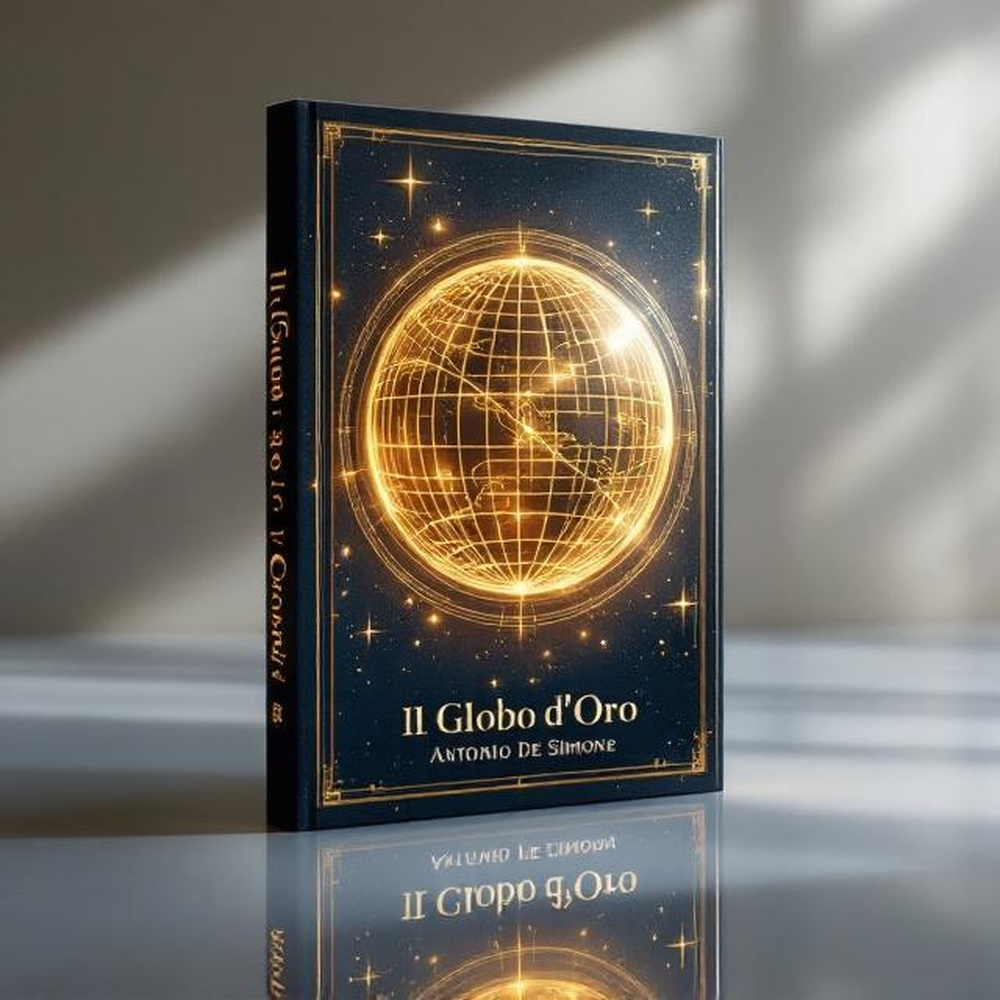

📚 Temmy Owokade | Book Marketing Portfolio

Bringing Stories to Life Through Creative Book Marketing

Welcome to my creative portfolio!

I'm Temmy Owokade, a book marketing enthusiast and creative storyteller passionate about helping authors present their books to readers through engaging promotional content and compelling visual experiences.

🎬 My Creative Services

- **Cinematic Book Trailers:** Engaging video concepts that capture the mood and story of a book.
- **Book Marketing:** Creative promotional strategies designed to improve book visibility.
- **Author Promotion:** Personalized author outreach and promotional campaigns.
- **Book Cover Presentation:** Creative visual concepts for showcasing books.
- **Social Media Promotion:** Content ideas to help authors connect with readers.

🌟 Portfolio Categories

1. Book Trailer Projects
Creative trailer concepts, scripts, storyboards, and promotional videos.

2. Book Cover & Promotional Designs
Visual concepts and promotional graphics for fictional and published books.

3. Author Marketing Campaigns
Sample marketing plans, author outreach messages, and book discovery strategies.

4. Creative Storytelling
Original concepts that transform book themes into engaging promotional experiences.

💼 My Approach

I believe every book has a story worth sharing. My approach combines creativity, strategic promotion, and visual storytelling to help authors communicate the value of their work.

🤝 Let's Connect

I'm open to connecting with authors, publishers, book lovers, and creative professionals.

**GitHub:** [Visit my profile](https://github.com/owokadetemmy)

**Location:** Nigeria

## 🖼️ Featured Portfolio Sample

Here is one of the visual samples included in my creative portfolio.

📖 Project 01: Premium Book Cover Presentation

**Project Type:** Book Cover Promotional Design

**Creative Focus:** Elegant book presentation, visual storytelling, and premium promotional aesthetics.

**Portfolio Category:** Book Cover & Promotional Designs

**Note:** This is a portfolio sample.

⭐ Thank you for exploring my portfolio!
